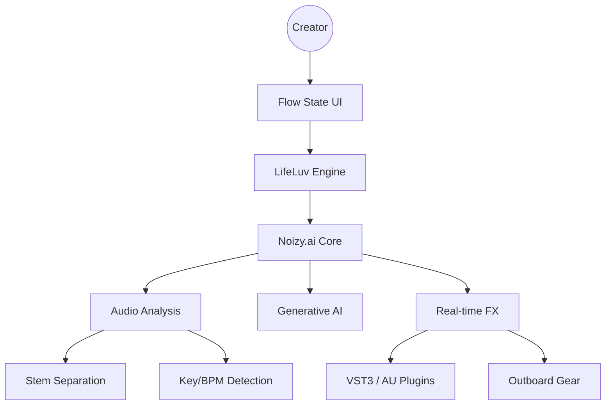

# NOIZYLAB: The Audio Singularity
**Status**: GENESIS | **AI**: GEMINI PROTOCOL | **Objective**: LIFELUV & FLOW

## 1. THE MISSION
To keep music alive and make people "FLOW" through "LIFELUV".
We are building **Noizy.ai**, an intelligent audio manipulation system that blurs the line between creator and creation.

## 2. CORE SYSTEMS

### [LIFE_LUV] (The Heart)
- **Concept**: A bio-feedback audio engine that adjusts music production parameters based on the user's emotional "Flow" state.
- **Technology**: Real-time DSP (Digital Signal Processing) coupled with Affective Computing (AI Sentiment/Biometric analysis).

### [NOIZY.AI] (The Brain)
- **Concept**: A generative music model capable of "Digital Professional Music & Sound Manipulation."
- **Capabilities**:
    - **Source Separation**: Deconstruct tracks into stems (Vocals, Drums, Bass).
    - **Style Transfer**: Apply the "texture" of one track to another.
    - **Intelligent Mastering**: Auto-leveling using perceptual loudness models (LUFS).

### [FLOW_STATE] (The Interface)
- **Concept**: A distraction-free, high-performance DAW (Digital Audio Workstation) overlay.
- **UX**: Dark mode, minimal latency, "Holographic" visualizations of sound waves.

## 3. ARCHITECTURE BLUEPRINT

## 4. IMMEDIATE DIRECTIVES
1.  **Initialize Codebase**: Setup Python (PyTorch/Librosa) and C++ (JUCE) scaffolding.
2.  **Audio Probes**: Create scripts to analyze local audio samples.
3.  **Flow Connector**: Establish a link between system performance (MC96Universe) and Audio Latency (`CoreAudio`).
